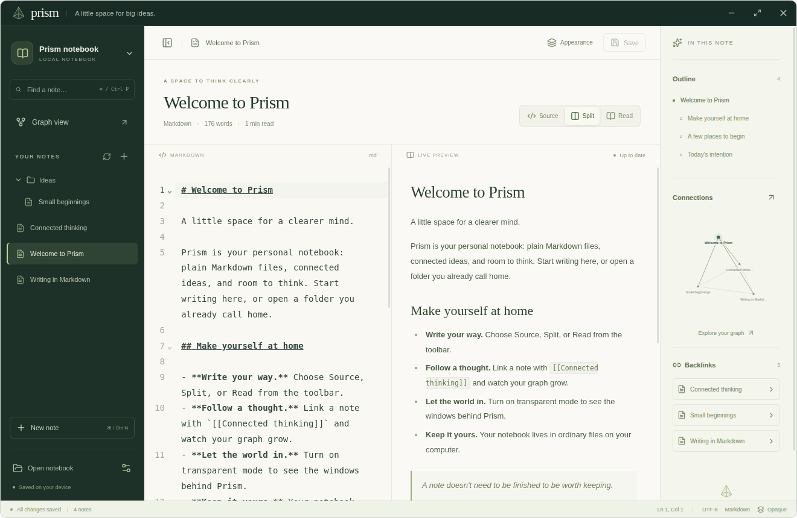

# Prism

A local Markdown notebook with live preview, connected notes, and a transparent desktop window. Built with Electron, React, TypeScript, and CodeMirror.



[See the graph view](docs/prism-graph.png).

## Run

Install Node.js **22.22.2 or later** (Node 24 recommended), then:

```sh
npm ci
npm start
```

Prism opens a starter notebook with four connected notes. Use **Open notebook** to choose your own folder. Existing files are never seeded or overwritten. The chosen folder and appearance preferences are remembered when you reopen the app.

On Linux and macOS, the starter folder is a symbolic link to a complete notebook in an adjacent `.prism-notebook-…` folder. When backing it up, copy the actual note files, not just the link. The **Open notebook** button's tooltip shows the resolved folder path. Windows uses an ordinary starter folder.

This is a desktop application; opening the HTML file in a browser does not provide notebook access.

## Write, read, connect

- **Source, Split, and Read:** switch between syntax-highlighted Markdown, live side-by-side preview, and a reading view.
- **Ordinary files:** search notes by name or content, create notes in nested folders, and save directly to Markdown files. Nothing is sent to a server.
- **Connected notes:** use `[[Note name]]`, `[[Note name|label]]`, `[label](folder/note.md)`, or extensionless `[label](folder/note)`. The graph and backlinks update as you write. Links such as `[[Note#Heading]]` and `[label](note.md#heading)` also scroll to the destination heading.
- **A clear workspace:** navigate the outline, hide sidebars with Focus mode, or explore the graph with pan and zoom.
- **True transparency:** enable **Appearance → Transparent window** and adjust background opacity. Text remains opaque; no blur is applied to the windows behind Prism.

Saving is explicit. Unsaved drafts survive switching between notes within the current session. Closing Prism, refreshing the notebook, or opening another folder asks you to save or discard those drafts. Drafts are kept in memory until saved, so save before terminating the process or shutting down the computer.

Prism checks for external changes before saving and keeps your draft if it detects a conflict. Each save captures the previous file before publishing the draft, and refuses to replace a new destination created during publication. Copy your draft before refreshing to load the external version. Use **Refresh notebook** to see files added or changed outside Prism.

Saves retain recovery files beside the note in a hidden `.prism-recovery/save-…` directory: `original.md`, `draft.md`, and a manifest. A `complete` marker identifies a settled save. On loading a notebook, Prism can restore a missing note from an unfinished save; it never replaces an existing destination or restores deliberately deleted notes from completed saves. Recovery copies are not automatically pruned in this release.

| Action | Windows / Linux | macOS |
| --- | --- | --- |
| Save current note | Ctrl+S | ⌘S |
| Save all changed notes | Ctrl+Shift+S | ⌘Shift+S |
| New note | Ctrl+N | ⌘N |
| Open notebook | Ctrl+O | ⌘O |
| Find a note | Ctrl+P | ⌘P |
| Source / Split / Read | Ctrl+1 / 2 / 3 | ⌘1 / 2 / 3 |
| Toggle graph | Ctrl+Shift+G | ⌘Shift+G |
| Find text in the editor | Ctrl+F | ⌘F |

## Desktop behavior and limits

Prism creates a native transparent window and uses alpha backgrounds. Actual composition depends on the operating system and desktop compositor. Electron documents limitations for native resizing and maximization of transparent windows, so Prism provides an **Expand / restore** button instead of native resize handles. The initial size fits the current screen. Opening DevTools can disable native transparency. See [Electron's transparent-window documentation](https://www.electronjs.org/docs/latest/tutorial/custom-window-styles#transparent-windows).

The first release supports UTF-8 `.md` and `.markdown` files (new files use `.md`). An existing UTF-8 byte-order mark is preserved on save and excluded from the editor text. Each note can be up to 2 MB; a notebook can load up to 2,000 notes and 64 MB of text. Hidden folders, `node_modules`, symbolic links, and unsupported filenames are skipped, with scan warnings shown in the app. Preview HTML is sanitized; scripts, forms, external image loading, and arbitrary local file access are blocked. Task-list checkboxes are displayed read-only; edit their Markdown source to change them.

Attachments, embedded notes, file renaming/deletion, synchronization, plugins, and signed installers are outside this first release. Run from source with the commands above. Windows and macOS compositor behavior needs testing on those desktops; automated Linux desktop tests verify the app's native window and editing flows.

## Development and checks

```sh
npm run check       # TypeScript, Markdown/filesystem tests, production build
npm run test:e2e    # Playwright against the actual Electron app
```

Linux CI uses `xvfb-run --auto-servernum npm run test:e2e`. The test suite uses temporary notebooks and user profiles, and captures a desktop screenshot in `test-results/`. Electron's sandbox is disabled only for automated test launches; normal `npm start` keeps it enabled.

The isolated renderer talks to a narrow preload bridge. The main process validates sender frames, confines filesystem operations to the chosen notebook, serializes writes, detects external changes, and preserves displaced versions during save publication.

See [IMPLEMENTATION.md](IMPLEMENTATION.md) for scope and progress, [save recovery](docs/save-recovery.md) for the publication and recovery design, and [AGENTS.md](AGENTS.md) for the project brief and branch/review workflow. Pull requests remain open for review and are not merged automatically.
