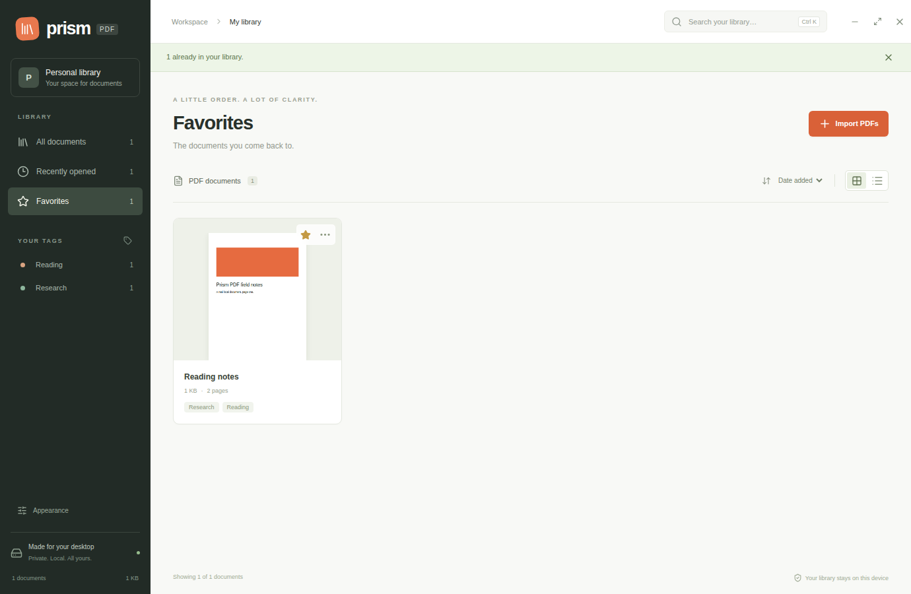

# Prism PDF

Prism PDF is a separate local desktop PDF library and reader in this repository. The Markdown workspace continues to run with `npm start`; launch this app with `npm run start:pdf`.



[See the PDF reader](docs/reader.png). Screenshots show the actual Electron app with a test document.

## Open from your desktop

On Linux or Windows through WSL, run `npm run install:pdf` once from the repository root after installing dependencies. This builds the app and adds **Prism PDF** to your applications menu. On WSL it also creates **Prism PDF** shortcuts on your Windows desktop and in the Windows Start menu, including redirected OneDrive desktops.

Double-click the desktop shortcut or search for **Prism PDF** in Start. The shortcut opens the built app directly without a terminal or rebuilding it. Opening it again brings the existing window forward. You can pin the Start menu shortcut for easier access.

The launcher uses this checkout and its installed Electron runtime, so keep the repository in place. After moving the repository, rerun `npm run install:pdf`; after updating the code, rebuild with `npm run build:pdf`. Installation preserves your PDF library. To remove the launchers, delete the Windows shortcuts and the `io.github.beautysamurai.PrismPDF.desktop` file under `${XDG_DATA_HOME:-~/.local/share}/applications`.

## Run locally

Use Node.js 22.22.2 or newer. From the repository root:

```sh
npm ci
npm run start:pdf
```

The app opens a native Electron window. Import PDFs using the system file picker, organize them with tags and favorites, and search their titles, filenames, and tags. Switch between grid and list views, or pick up a document from Recently opened. The built-in PDF.js reader provides page navigation, zoom, rotation, password entry, and a remembered reading position. You can open a managed document in your system PDF app or reveal its file in the file manager.

Use **Ctrl+O / ⌘O** to import and **Ctrl+K / ⌘K** to search. In the reader, focus the page viewport and use the arrow keys or Page Up / Page Down to turn pages.

## Your library

Imported PDFs are copied into Prism PDF's application-data directory, separate from Prism's Markdown notes. Each import is limited to 100 MiB, with up to 100 files per import and 2,000 documents in the library. Identical files are detected by content and imported once. The original selected file is not edited or deleted. The library keeps its own metadata and copies so it remains available when the source file moves. Back up the app's entire `library` directory to retain your documents and organization.

The default library locations are `%APPDATA%/prism-pdf/library` on Windows, `~/Library/Application Support/prism-pdf/library` on macOS, and `$XDG_CONFIG_HOME/prism-pdf/library` (normally `~/.config/prism-pdf/library`) on Linux. **Show library copy** opens its location in the system file manager.

**Remove** removes the catalog entry and its tags, favorite, and reading position. Both the original and the managed PDF remain on disk. Removed copies can be imported again from `library/documents`; this release does not automatically reclaim their disk space. The displayed storage total counts cataloged PDFs only. A damaged catalog is reported without overwriting it; restore its backup before continuing.

Failed imports clean up copies that can still be verified as belonging to the failed operation. If a file was replaced, edited, or its ownership is uncertain, it is kept and its recovery path is shown in the error.

PDF rendering uses bundled workers, fonts, character maps, and WebAssembly resources. It does not require a remote PDF service. Search covers library metadata; it does not OCR scanned pages or index the full PDF text.

Enable **Appearance → Transparent window** and adjust background opacity to see the desktop through the interface. Document pages remain opaque. Transparency depends on the operating system compositor. As with Prism's Markdown window, Electron's transparent-window limits mean this app uses its own **Expand / restore** control rather than native resizing.

This first version is a document manager and reader. Pages render to canvas; text selection, PDF editing, merging, annotations, OCR, cloud sync, and signed installers are not included. Passwords are used only for the current reading session and are not saved. The app validates PDF headers on import and reports damaged documents when previewing them. As with other filesystem applications, its checks are not a security boundary against another process concurrently replacing its application-data directories.

## Development

Run these commands from the repository root:

```sh
npm run check:pdf     # TypeScript, library tests, and desktop build
npm run test:pdf:e2e  # Actual Electron desktop journeys; needs a display
```

On Linux without a display, run the desktop suite with `xvfb-run --auto-servernum npm run test:pdf:e2e`. The desktop suite uses temporary profiles; it does not alter your normal library.

Source code is in `pdf-manager/src/`; generated output is in `pdf-manager/dist/`. Dependencies and their pinned versions are managed by the repository-root package manifest and lockfile.
